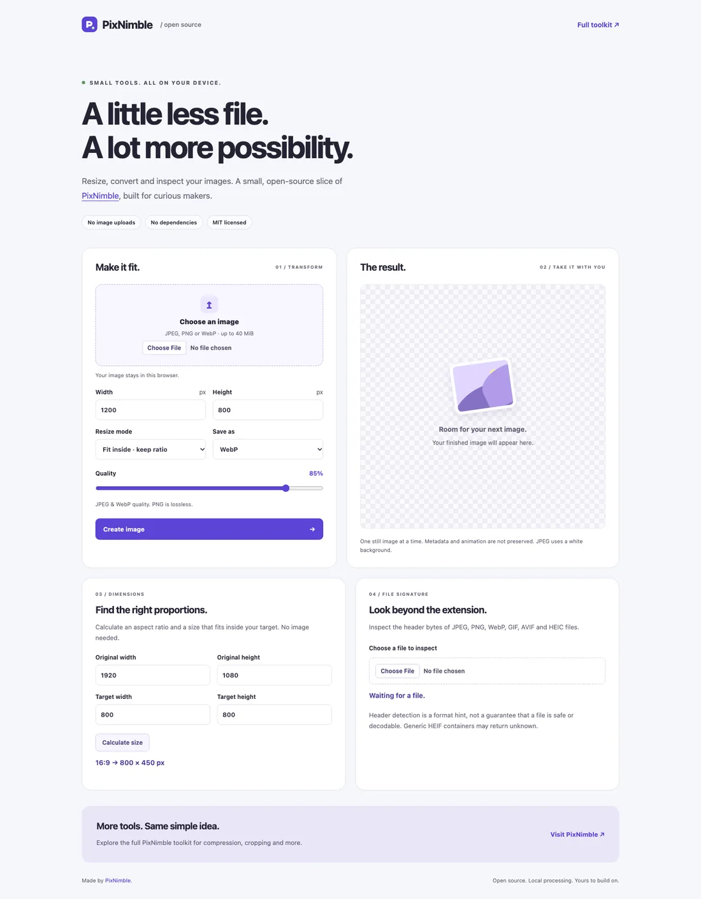

<p align="center"></p>

# PixNimble Image Tools

**Small, dependency-free image utilities for the web.** Calculate dimensions, inspect file signatures, and resize or convert images directly in the browser.

Built from selected image-processing ideas in **[PixNimble — Free Online Image Tools](https://pixnimble.com)**. This repository is a standalone developer toolkit and playground; it contains a small part of the product's functionality.

**[Try the full PixNimble toolkit →](https://pixnimble.com)** · [API reference](docs/API.md) · [Tiếng Việt](README.vi.md) · [MIT license](LICENSE)

## What's inside

| Utility                | What it does                                                 | Environment       |
| ---------------------- | ------------------------------------------------------------ | ----------------- |
| `aspectRatio`          | Reduce dimensions to a ratio such as `16:9`                  | Browser + Node.js |
| `calculateResize`      | Calculate fit, center-crop or stretch geometry               | Browser + Node.js |
| `detectImageSignature` | Recognize JPEG, PNG, WebP, GIF, AVIF and HEIC headers        | Browser + Node.js |
| `detectImageType`      | Read a small prefix of a Blob or File to identify its format | Browser + Node.js |
| `transformImage`       | Resize and convert JPEG, PNG and WebP using Canvas           | Browser           |

No runtime dependencies, build step, API key or image upload endpoint. The demo has no analytics or third-party scripts.

## Run the playground

Requires **Node.js 22 or newer** for the local server and tests.

```sh
git clone https://github.com/farahdo101/pixnimble-image-tools.git
cd pixnimble-image-tools
npm start
```

Open **http://127.0.0.1:4174/demo/**. No `npm install` is needed.

Choose an image, enter the target size, select a format, and download the result. The playground also includes a dimension calculator and a file-signature inspector. Open it through the local server; ES modules do not work reliably over `file://` URLs.



## Use the utilities

Copy the `src/` directory into your project and keep its relative imports. This repository is not published to npm; there is no registry package to install.

```js
import { aspectRatio, calculateResize, detectImageType } from './src/index.js';

aspectRatio(1920, 1080); // '16:9'
calculateResize(1920, 1080, 800, 800); // width: 800, height: 450, plus source crop

const type = await detectImageType(fileInput.files[0]);
console.log(type?.mime); // e.g. 'image/png'; null for unknown signatures
```

In a browser:

```js
import { transformImage } from './src/browser.js';

const result = await transformImage(fileInput.files[0], {
  width: 1200,
  height: 800,
  mode: 'contain',
  format: 'image/webp',
  quality: 0.85,
});

// result.blob is ready for a preview or a download.
// See demo/app.js for a complete example with object URL cleanup.
```

For conversion without resizing, omit both `width` and `height`.

## Resize behavior

- **Contain:** fit inside the requested bounds, keeping the aspect ratio. No padding; the result can be smaller than one target dimension.
- **Cover:** fill the exact requested dimensions with a centered crop.
- **Stretch:** use the exact requested dimensions, allowing distortion.

Upscaling is allowed. Calculations round to whole pixels, with a minimum of one pixel per side.

## Privacy and limitations

Image processing stays on the device. The local server serves files and has no upload route. Visiting the PixNimble link opens the separate production website, which has its own [privacy policy](https://pixnimble.com/privacy).

- Browser transforms accept **JPEG, PNG and WebP**, up to **40 MiB**, **8,192 px per side** and **32 megapixels** for decoded inputs and outputs. The pure dimension calculator does not allocate pixels and permits dimensions up to 1,000,000.
- The header inspector recognizes more formats than the transform demo. HEIC, AVIF and GIF detection does **not** imply conversion support.
- Header matching is a format hint, **not complete file validation or a security boundary**. Unsupported, generic HEIF, non-leading or extended-size `ftyp` boxes may return `null`; compatible brands outside the first 256 bytes are not inspected by `detectImageType`.
- Processing exports a single still image. Animation, EXIF and other original metadata are not preserved. Browser decoding applies orientation; color profiles and HDR appearance may change.
- JPEG uses white for transparent pixels. PNG/WebP can preserve transparency. PNG ignores the quality option.
- Output size is not guaranteed to be smaller. Browser encoders vary; unsupported requested output formats raise an error instead of silently returning PNG.
- Pixel limits are checked after browser decoding; they do not prevent all decoder memory allocation. Large images may still exhaust memory on constrained devices.

## Development

```sh
npm run check
```

This checks JavaScript syntax and runs the Node.js tests. Browser checks and their setup are documented in [test/BROWSER.md](test/BROWSER.md).

The source modules, demo, server and tests are plain JavaScript ES modules. See [CONTRIBUTING.md](CONTRIBUTING.md) for contribution guidance.

## About PixNimble

[PixNimble](https://pixnimble.com) offers free online tools for image compression, resizing, conversion and cropping. This repo shares focused utilities for developers who want to learn from or build on browser image processing.

The code in this repository is available under the [MIT license](LICENSE). This license covers this repository, not the full PixNimble production codebase, and does not grant trademark rights to the PixNimble name.
